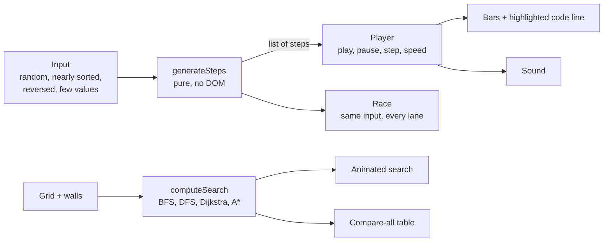

# AlgoViz

**Watch an algorithm think.** Sorting, pathfinding and binary search trees drawn out one step at a time, with the line of code doing each step highlighted, a counter for every comparison and swap, and sound if you want to hear them work.


## Why it's interesting

- **Race mode.** Up to six sorts run on the same numbers, one comparison or swap per tick each, so the finishing order is the operation count. Switch the input to *nearly sorted* and insertion sort beats quick sort. Switch to *reversed* and quick sort (last-element pivot) falls to its O(n²) worst case.
- **You can hear them.** Every compared or swapped bar plays a pitch that rises with its value, and a sorted array ends with a rising sweep. Each algorithm has its own sound: heap sort's sift-downs, merge sort's ladders.
- **Compare all four searches on your own maze.** Draw walls, then run BFS, DFS, Dijkstra and A\* on the same grid in one click. A table shows cells explored and path length, and whether each path is the shortest.
- **The animations are the real algorithm.** Each one runs as a pure function that records every step, and the page plays those steps back. That's what makes pause, single-step and mid-run edits safe, and it's what lets the tests check the algorithms themselves.

| Sorting bench | Pathfinding, with all four compared | Binary search tree |
|---|---|---|
|  |  |  |

## How it works



## Quick start

```bash
git clone https://github.com/Janat-Yasser/algoviz.git && cd algoviz
npm install
npm start
```

Open http://localhost:3000. No database or API keys. On the sorting page, **Space** plays and pauses, **→** steps, **R** gives new numbers.

<details>
<summary>What's inside</summary>

| Module | Algorithms | What you can do |
|---|---|---|
| Sorting | Bubble, selection, insertion, merge, quick, heap | Step through with the code highlighting, pick the input shape, turn on sound |
| Race | All six sorts | Run any of them side by side on the same numbers and see who finishes first |
| Pathfinding | Dijkstra, A\*, BFS, DFS | Draw walls, move start and end, animate one search or compare all four |
| Trees | Binary search tree | Insert, search and delete with the path animated; in-order, pre-order and post-order walks |

</details>

<details>
<summary>Design</summary>

A dark graphite bench, so the algorithm's colours are the only bright thing on screen. Bars rest in grey; amber means comparing, red means swapping, mint means in its final place, violet marks the pivot, and active bars glow. The canvases have faint scale lines, like an instrument screen. Type is Space Grotesk, with JetBrains Mono for code and numbers, self-hosted under `public/fonts` (SIL Open Font License).


</details>

<details>
<summary>Project layout</summary>

```
server.js                     Express app
models/Algorithm.js           catalogue: names, complexity, descriptions
controllers/, routes/         sorting, pathfinding, trees, race
views/                        EJS pages (home, sorting, race, pathfinding, trees)
public/js/algorithms/         sorting.js, pathfinding.js, trees.js: pure algorithms + players
public/js/race.js             race lanes
public/js/hero.js             the live sort on the home page
public/js/sound.js            Web Audio sonification
test/algorithms.test.js       node:test suite
```

</details>

<details>
<summary>Tests</summary>

```bash
npm test
```

Every sort ends sorted without losing elements, highlighted code lines exist, bubble sort's early exit makes its best case O(n), insertion sort counts its stopping comparison, BFS, Dijkstra and A\* agree on shortest paths, paths are valid, and the BST keeps its ordering.

</details>

## Roadmap

- AVL and red-black trees, heaps, hash tables
- Step backwards
- Static build for GitHub Pages (the server only renders templates)

MIT licensed.
