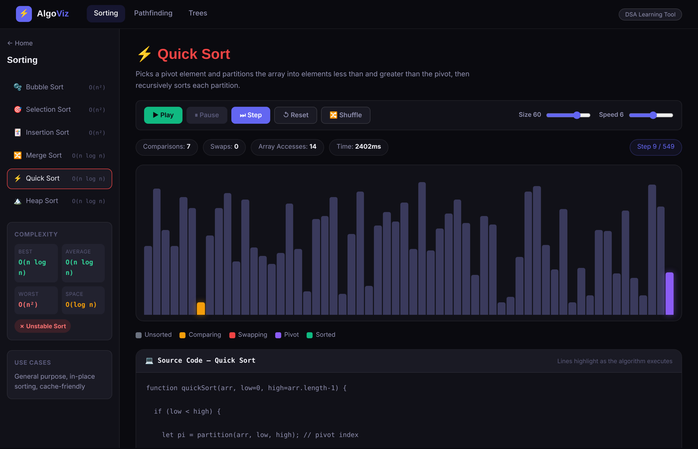
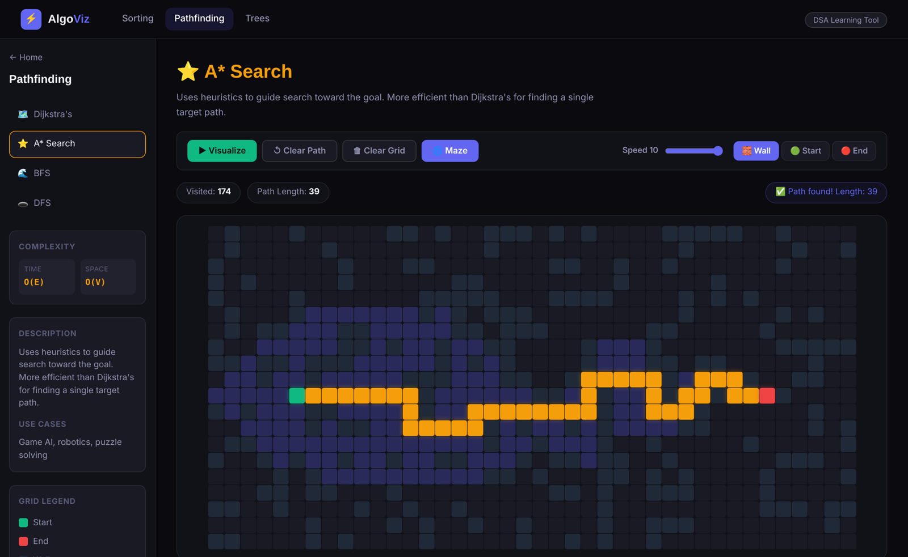
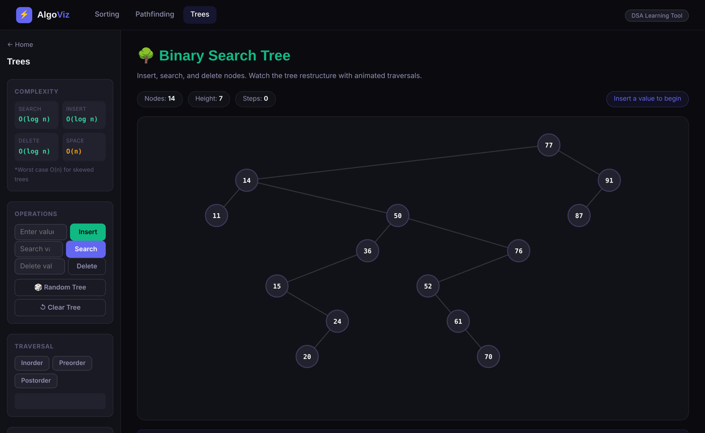

# AlgoViz

**Learn data structures and algorithms by watching them run.**

AlgoViz is an interactive visualizer for the algorithms every CS student meets first: sorting, graph pathfinding and binary search trees. Each one animates step by step, at a speed you control, with its time and space complexity next to it.




---

## What's inside

| Module | Algorithms | What you can do |
|---|---|---|
| **Sorting** | Bubble, Selection, Insertion, Merge, Quick, Heap | Generate a random array, pick an algorithm, and watch comparisons and swaps happen bar by bar |
| **Pathfinding** | Dijkstra, A\*, BFS, DFS | Draw walls on a grid, move start/end, generate a maze, then watch the search frontier expand and the shortest path light up |
| **Trees** | Binary Search Tree | Insert, search and delete values; run in-order, pre-order and post-order traversals with animated highlighting |

Every algorithm page shows:
- **Source code that highlights line by line** as the algorithm runs, with a plain-English explanation of each step
- Best, average and worst-case **time complexity**, plus **space complexity**
- A plain-English description and real-world use cases
- Live counters (comparisons, swaps, nodes visited, path length, tree height)
- Play, pause, **single-step**, reset and shuffle controls, plus speed and array-size sliders

| Pathfinding (A\* through a generated maze) | Binary search tree |
|---|---|
|  |  |

## Quick start

```bash
git clone https://github.com/Janat-Yasser/algoviz.git
cd algoviz
npm install
npm run dev        # or: npm start
```

Open **http://localhost:3000**. No database or API keys are needed.

## How it's built

```
algoviz/
├── server.js                  # Express app + routes
├── models/Algorithm.js        # Algorithm catalogue: names, complexity, descriptions, use cases
├── controllers/               # One controller per module (sorting, pathfinding, trees)
├── routes/                    # /sorting, /pathfinding, /trees
├── views/
│   ├── layouts/main.ejs
│   ├── index.ejs              # Landing page
│   └── algorithms/            # One page per module
└── public/
    ├── css/style.css
    └── js/algorithms/         # The animation engines (sorting.js, pathfinding.js, trees.js)
```

The server only renders pages and serves algorithm metadata. All the animation runs client-side in plain JavaScript, with no framework. Each algorithm emits a list of steps that the renderer plays back, so pause and speed control come for free.

## Roadmap

- [ ] More structures: AVL / red-black trees, heaps, hash tables
- [ ] Step backwards, not just forwards
- [ ] Side-by-side race between two sorting algorithms
- [ ] Deploy a live demo

## License

MIT
